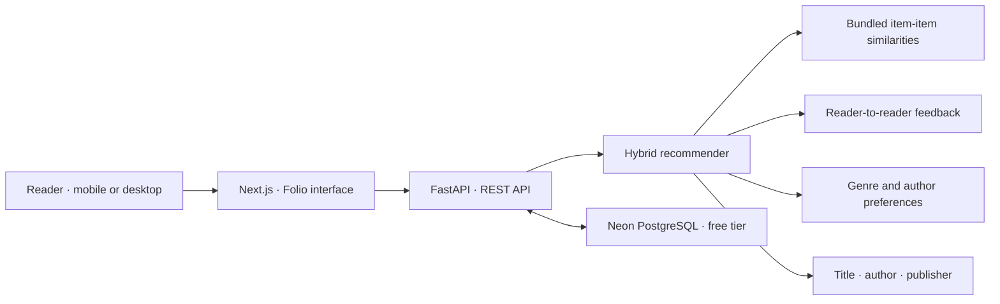

<div align="center">

# 📚 Folio

### Find your next favorite. Not just your next book.

Thoughtful, explainable book discovery powered by a hybrid recommendation engine.

[](https://github.com/Shreyansh01234/book-recommender-system1/actions/workflows/ci.yml)
[](https://nextjs.org/)
[](https://fastapi.tiangolo.com/)
[](https://www.postgresql.org/)

**Live demo:** [Open Folio](https://shreyansh01234.github.io/book-recommender-system1/)

</div>

---

Folio grew from a book-recommendation proof of concept into a full-stack portfolio project: browse a real catalog, teach the app your taste, rate books, and see **why** each recommendation might be right for you.

> **A note on the source data:** the supplied model contains item-similarity scores for 746 books and a popularity table, but no raw user–book rating history or book descriptions. Folio combines those existing collaborative-filtering similarities with feedback from its own readers, available book metadata, and explicitly stated preferences. Genre labels are title-keyword estimates, not verified publisher metadata. The existing source popularity scores use a 0–10 scale; Folio converts them to a 0–5 display scale.

## ✨ Explore Folio

| Discover | Personalize | Understand |
|:--|:--|:--|
| Search by title or author, filter by estimated genre, and explore beautifully presented book cards. | Set genre and author preferences for an immediate cold-start experience. Your ratings make later picks more personal. | See the actual signals behind a pick: similar books, readers with similar rating patterns, metadata overlap, or your preferences. |

- ⭐ **Rate as you read:** save and update 1–5-star ratings.
- 📚 **Build your shelf:** revisit your rating history.
- 🔎 **Find books quickly:** combine title, author, and genre filters.
- 🧩 **Explainable hybrid ranking:** collaborative signals, book metadata, stated preferences, and popularity.
- 📱 **Responsive experience:** an editorial-inspired UI designed for desktop and mobile.
- 🔐 **PostgreSQL-ready:** books, reader profiles, preferences, and ratings use SQLAlchemy.
- 🧪 **Honest evaluation:** testable Precision@K, Recall@K, and RMSE tools—with no invented benchmark numbers.

## 🚀 Live links

The frontend is live on GitHub Pages and connected to the Render API.

- **Web app:** [Folio — Book Discovery](https://shreyansh01234.github.io/book-recommender-system1/)
- **API:** [Folio Book Discovery API](https://folio-book-api.onrender.com)
- **API health:** [Health check](https://folio-book-api.onrender.com/health)
- **Interactive API docs:** [Swagger UI](https://folio-book-api.onrender.com/docs)

## 🖥️ Product preview

The app opens on the **Discover** library. Use **For you** to set reading preferences and view explained hybrid picks; select the stars on any book to save it to **My shelf**.

## 🏗️ How it works



### Recommendation signals

1. **Collaborative filtering:** the original cosine item-item model exports its top 30 neighbors for each of the 746 modeled titles. As Folio readers provide overlapping ratings, the ranker can additionally use reader-to-reader rating-pattern similarity.
2. **Content matching:** token overlap across available titles, author names, and publishers. This is a lightweight metadata fallback—not book-description understanding.
3. **Cold start:** stated genre and author preferences plus popularity, even before a reader has rated anything.
4. **Why this pick?** Each result explains whichever signals actually apply; unavailable evidence is not fabricated.

The current ranking blend assigns 52% to collaborative feedback, 20% to metadata overlap, 20% to explicit preferences, and 8% to catalog popularity. Results blend these inputs with a small popularity boost, so the final display score is a **ranking score**, not a predicted star rating.

## 🧰 Technology

| Layer | Stack |
|:--|:--|
| Web | Next.js 16 · React 19 · TypeScript · responsive CSS |
| API | Python · FastAPI · Pydantic |
| Storage | PostgreSQL on Neon; SQLite for local development and tests |
| Data and model | Original cosine item similarities · exported JSON catalog |
| Quality | pytest · ESLint · TypeScript · GitHub Actions |
| Free hobby deployment | GitHub Pages · Render Free API · Neon Free Postgres |

## 🛠️ Run locally

Prerequisites: Python 3.11+ and Node.js 20.9+.

Open two PowerShell terminals at the repository root.

**1. Start the API**

```powershell
py -m venv .venv
.\.venv\Scripts\Activate.ps1
python -m pip install -r backend\requirements-tools.txt
Set-Location backend
Copy-Item .env.example .env
python -m app.seed_catalog
uvicorn app.main:app --reload
```

API: `http://localhost:8000` · interactive docs: `http://localhost:8000/docs`

**2. Start the web app**

```powershell
Set-Location frontend
Copy-Item .env.example .env.local
npm ci
npm run dev
```

Open `http://localhost:3000`. To use PostgreSQL locally, set `DATABASE_URL` in `backend\.env`. SQLite is the local default.

Folio keeps a browser-generated demo reader ID in local storage; this is **not account authentication**. Add a real authentication provider before using the app for private or sensitive user data.

## ☁️ Deploy for free

The free hobby setup is **GitHub Pages (frontend) + Render Free (API) + Neon Free (PostgreSQL)**. It avoids Render’s expiring free database and Render’s non-persistent local filesystem. The Next.js app is statically exported for GitHub Pages and calls the separate FastAPI service.

> **Free-tier trade-off:** Render Free spins the API down after 15 minutes without traffic; the first request after idle can take about a minute. Neon Free is persistent, but has storage, compute, and transfer limits. Vercel Hobby is intended for personal, non-commercial projects. Free-tier limits and terms can change—review the linked provider pages before deploying.

1. **Create the database:** make a free project on [Neon](https://neon.com/), then copy the connection string for its Postgres database. Keep it private.
2. **Deploy the API:** sign in to [Render](https://render.com/), choose **New → Blueprint**, and select this GitHub repository. The root [`render.yaml`](./render.yaml) creates a free Python web service. Set `DATABASE_URL` to the Neon connection string and `CORS_ORIGINS` to include `https://shreyansh01234.github.io`.
3. **Enable GitHub Pages:** in the repository, open **Settings → Pages** and set the build/deployment source to **GitHub Actions**.
4. **Deploy the frontend:** push to `main` or run **Deploy frontend to GitHub Pages** from the repository’s Actions tab. The workflow in [`.github/workflows/deploy-frontend.yml`](./.github/workflows/deploy-frontend.yml) builds the app with the Render API URL and publishes it at `https://shreyansh01234.github.io/book-recommender-system1/`.
5. **Verify before sharing:** open the GitHub Pages URL and confirm search, recommendations, and rating requests reach the API. Open the API [health check](https://folio-book-api.onrender.com/health) and [docs](https://folio-book-api.onrender.com/docs) as well.
6. **Publish the website link:** add it to **Live links** only after the Pages deployment and frontend/API integration are verified.

Render Blueprints will ask you to provide `DATABASE_URL` and `CORS_ORIGINS`; neither setting should be committed to Git. Never publish database credentials, tokens, or production secrets.

## 🛣️ API

Interactive request and response schemas are available at `/docs`.

| Method | Route | Description |
|:--|:--|:--|
| `GET` | `/health` | Deployment health check |
| `GET` | `/api/v1/books?query=&genre=&author=&limit=&offset=` | Search, filter, and paginate the catalog |
| `GET` | `/api/v1/books/facets` | Available estimated genres and authors |
| `POST` | `/api/v1/users` | Create or retrieve a reader profile |
| `GET` | `/api/v1/users/{id}` | Retrieve a reader profile |
| `PUT` | `/api/v1/users/{id}/preferences` | Save genre and author preferences |
| `GET` | `/api/v1/users/{id}/history` | View saved book ratings |
| `POST` | `/api/v1/ratings` | Add or update a 1–5-star rating |
| `GET` | `/api/v1/recommendations?user_id={id}&limit=12` | Return ranked picks with explanations |

## 📈 Evaluation

The checked-in dataset does not contain raw user–book rating rows. Without held-out ground truth, a meaningful offline benchmark cannot be calculated from the similarity matrix by itself.

| Metric | Verified value | Why it is not shown as a score |
|:--|:--|:--|
| Precision@10 | **Not measured** | Requires actual relevant items for test users |
| Recall@10 | **Not measured** | Requires held-out relevant user–book pairs |
| RMSE | **Not measured** | Requires observed ratings and rating predictions |

Supply a held-out CSV with columns `user_id,book_id,rating,predicted_rating,rank` (put `0`/blank in `rank` for a test pair that was not recommended), then run from `backend`:

```powershell
python -m pip install -r requirements-tools.txt
python -m scripts.evaluate path\to\held-out-predictions.csv --k 10 --relevance-threshold 4
python -m pytest tests -q
```

Precision and recall are macro-averaged per user; RMSE is calculated over held-out ratings. Only publish results from a documented test split.

## 🗂️ Project layout

```text
backend/
  app/                 FastAPI routes, data models, ranking, compact model artifacts
  scripts/             Original-model export and held-out metric evaluation
  tests/               API integration, ranking, and metric tests
frontend/
  src/app/             Next.js app, responsive Folio UI, app metadata
.github/workflows/     Automated CI for backend and frontend
render.yaml            Free Render API service configuration
```

## 🗺️ Roadmap

- [x] Responsive editorial-style book discovery UI
- [x] Hybrid recommendation explanations
- [x] Reader profiles, preferences, ratings, and history
- [x] Local SQLite + PostgreSQL connection support
- [x] Backend tests, frontend checks, and evaluation utilities
- [ ] Publish and verify the live app, API, and docs
- [ ] Replace heuristic genres with a verified genre-enriched dataset
- [ ] Add authenticated reader accounts
- [ ] Benchmark on a documented user-level hold-out split
